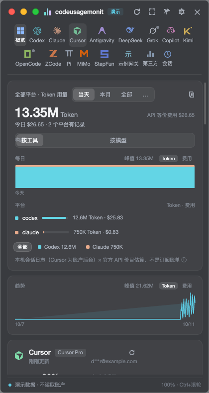
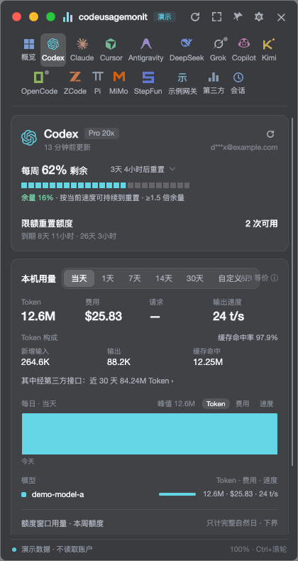
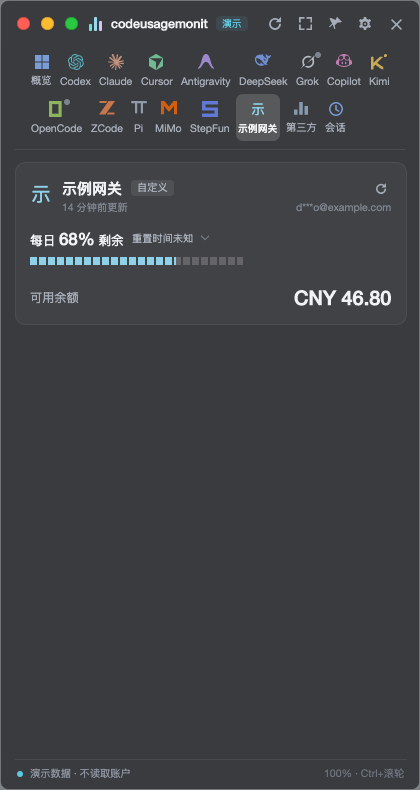
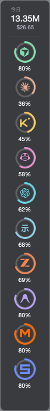

# codeusagemonit

macOS 菜单栏的 AI 编程工具用量监控。常驻菜单栏，按平台展示额度余量，统计本机产生的 token 用量与费用。

## 截图

以下均为 `codeusagemonit --demo` 演示数据的界面（不含任何真实账户信息）。

| 完整面板 · 概览 | 平台详情 · Codex | 自定义平台 · 示例网关 | Edge dock 窄条 |
| --- | --- | --- | --- |
|  |  |  |  |

## 功能

- **平台额度监控**：内置 13 个平台（Codex / Claude / Cursor / Antigravity / DeepSeek / Grok / Copilot / Kimi / OpenCode / ZCode / Pi / MiMo / StepFun），新装默认启用其中 6 个，其余在设置里按需开启；也支持自定义 HTTP 平台。
- **本机用量统计**：读取本机会话日志，统计每次请求的 token 与费用（价目表每天与仓库同步，断网用内置价目），支持 SQL / CSV / JSON 导出。
- **套餐归属**：把本机会话按账号与套餐归位，额度消耗对应到具体订阅。
- **热力图**：按日历查看历史用量分布。
- **多种窗口尺寸**：小 / 中 / 大 / 完整面板，另有 edge dock 窄条——贴边竖排，只显示各平台剩余额度的弧形进度。
- **中转站看板**：经过第三方中转接口的用量单独成页。
- **WebDAV 同步**：配置与历史数据在多机间同步；密钥不入备份。
- **codeusage CLI**：命令行查询与导出，供脚本和其他工具使用。
- 界面中英双语；除你主动配置的 WebDAV 同步外，用量与费用数据不出本机。

## 技术栈

C# / .NET 8 / Avalonia（原生 macOS 应用，非 Electron）。凭据存放在 macOS 钥匙串；自启动用 LaunchAgent，单实例用 Unix domain socket。

## 使用

- **App**：`dist/osx-arm64/CodeUsageMonit.app` —— 拷贝到「应用程序」或任意位置双击运行。未经过 Apple 公证，如被 Gatekeeper 拦截：右键 → 打开。
- **CLI**：`dist/osx-arm64/cli/codeusage`（依赖同目录 dll，移动请整目录移动）。可 `ln -sf $PWD/dist/osx-arm64/cli/codeusage /opt/homebrew/bin/codeusage`。
- 首次运行 `codeusagemonit --demo` 可看演示数据；`codeusage --self-test` 与 `codeusagemonit --self-test` 运行内置自检。
- 数据目录：`~/Library/Application Support/codeusagemonit`（GUI 与 CLI 共用；exe 旁放 `portable.txt` 可强制便携模式）。

## 注意：StepFun 凭据的并发刷新

StepFun 的 Oasis-Token 临近过期时会自动滚动刷新，新凭据写回钥匙串。写回前的去重是进程内的：CLI 与桌面端同时刷新同一个 StepFun 账户时存在一个并发窗口——两边各自刷新、后写者胜出，落后的一次查询可能用到刚被顶替的旧凭据，下一次刷新即自愈。因此建议避免同时用 CLI 和桌面端查询 StepFun。

## 构建

```sh
./build-macos.sh    # 需要 .NET SDK（brew install dotnet）；产出 dist/osx-arm64/
```
